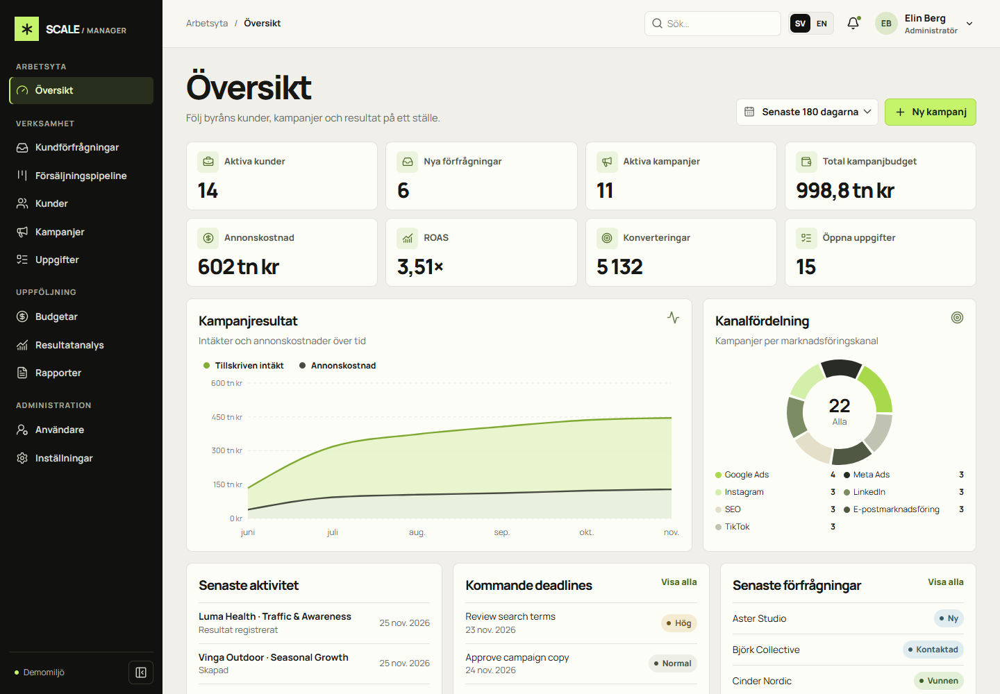

# SCALE Manager

SCALE Manager är ett internt CRM för den fiktiva byrån SCALE Digital. Här kan teamet följa en kundförfrågan från första kontakt till kampanj, budget och uppföljning.

- Kundregister med arkivering, kundhistorik och kampanjer.
- Kundförfrågningar och säljpipeline med tilldelning och konvertering till kund.
- Kampanjer, manuellt registrerade resultat, budgetvarningar och uppgifter.
- Resultatanalys, CSV-rapporter och tre behörighetsnivåer.
- Svenska med SEK och engelska med USD. Belopp lagras i SEK och räknas om med den illustrativa kursen 1 USD = 10 SEK.

Byggt med C#, ASP.NET Core 10, Identity, EF Core och SQLite. Gränssnittet använder React, TypeScript, Vite, Tailwind CSS, Recharts och i18next.

## Starta lokalt

Kör backend från projektmappen i Ubuntu eller WSL med .NET 10 på sökvägen.

```sh
dotnet run --project backend
```

Om SDK:n ligger i `~/.dotnet`, använd `~/.dotnet/dotnet` i kommandot. Migreringar och demodata skapas vid första starten i Development.

Öppna en separat terminal för frontend och kör följande kommandon.

```powershell
cd frontend
npm.cmd ci
npm.cmd run dev
```

Öppna [arbetsytan](http://localhost:5175). API:t körs på `http://localhost:5082/api` och OpenAPI finns på [openapi/v1.json](http://localhost:5082/openapi/v1.json). Vite skickar API-anropen vidare, så webbläsaren använder samma origin för inloggning och API.

| Roll | Demokonto |
| --- | --- |
| Administratör | `admin@scale.example` |
| Projektledare | `manager@scale.example` |
| Medarbetare | `employee@scale.example` |

Demolösenordet är `ScaleDemo!2026` för alla tre. Kontona skapas bara i Development. Använd en separat databas för produktionsdata. En första produktionsadministratör kan skapas via `Bootstrap__Email` och `Bootstrap__Password` från en hemlighetshanterare.

## SCALE Digital

Importen körs från Inställningar och läser SCALE Digitals kontakt- och konsultationsförfrågningar via en skyddad endpoint. Ange `Digital__BaseUrl` och `Digital__Token` i backendprocessens miljö. Samma nyckel anges som `Integration__SubmissionsToken` i SCALE Digital. CRM:et fungerar med egna poster och demodata när integrationen är frånkopplad. [Konfiguration och lokalt integrationstest](docs/scale-digital-integration.md).

Utgifter och intäkter registreras manuellt. Valutakursen är fast. Tester kan köras med `dotnet test tests` i WSL och `npm.cmd test`, `npm.cmd run lint`, `npm.cmd run build` samt `npm.cmd run e2e` i frontend. Kör webbläsartesterna mot en egen lokal demodatabas eftersom de skapar poster. Installera Playwright Chromium med `npx.cmd playwright install chromium` eller välj en installerad webbläsare med `PLAYWRIGHT_CHANNEL`.

## Gränssnitt

[Översikt](docs/screenshots/dashboard.png) · [Kunder](docs/screenshots/customers.png) · [Pipeline](docs/screenshots/pipeline.png) · [Kampanjer](docs/screenshots/campaigns.png) · [Resultatanalys](docs/screenshots/analytics.png) · [Mobil](docs/screenshots/mobile.png)



